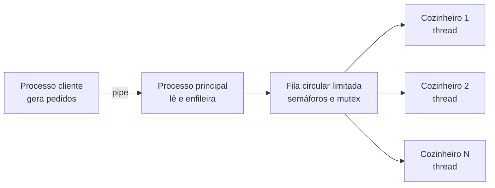

# Simulador de lanchonete

## 1. Sobre o projeto

O Simulador de lanchonete é uma aplicação de terminal escrita em C para demonstrar conceitos de sistemas operacionais em uma situação simples: clientes fazem pedidos, os pedidos aguardam em uma fila e cozinheiros trabalham neles em paralelo.

O projeto foi pensado como exemplo acadêmico de programação concorrente, sincronização e comunicação entre processos usando APIs POSIX. A preparação dos produtos é simulada com pausas; o programa não depende de arquivos, banco de dados, rede ou serviços externos.

## 2. O que o programa demonstra

| Conceito | Onde aparece | Função no simulador |
| --- | --- | --- |
| Processos POSIX | `fork`, `_exit`, `waitpid` | O processo filho representa os clientes que geram pedidos. O processo principal aguarda seu encerramento. |
| Comunicação entre processos | `pipe`, `write`, `read` | O processo cliente envia cada pedido ao processo principal por um pipe anônimo. |
| Threads POSIX | `pthread_create`, `pthread_join` | Cada cozinheiro é uma thread independente que pode preparar pedidos simultaneamente. |
| Semáforos POSIX | `sem_init`, `sem_wait`, `sem_post` | Controlam as vagas livres e a quantidade de pedidos disponíveis na fila. |
| Mutexes | `pthread_mutex_lock`, `pthread_mutex_unlock` | Protegem os dados compartilhados da fila e evitam que mensagens de threads se misturem no terminal. |
| Produtor–consumidor | Processo cliente, fila e cozinheiros | O processo cliente produz pedidos; as threads cozinheiras consomem os pedidos da fila. |

## 3. Arquitetura



O programa começa como um único processo. Depois de criar o pipe, chama `fork`:

1. O **processo filho** gera pedidos com produtos aleatórios e os envia pelo pipe.
2. O **processo principal** recebe os pedidos e os coloca na fila compartilhada pelas threads.
3. Cada **thread cozinheira** retira um pedido da fila, simula o preparo e registra a entrega.
4. Ao final, o processo principal sinaliza o encerramento dos cozinheiros e espera por todas as threads e pelo processo filho.

Os produtos possíveis são hambúrguer, pizza, salada, suco e batata frita. Cada pedido contém um número identificador e o índice do produto.

## 4. A fila e a sincronização

A fila tem capacidade configurável e funciona como um buffer circular. Os índices `head` e `tail` indicam, respectivamente, de onde retirar e onde inserir o próximo pedido. Ao chegar ao fim do vetor, cada índice volta ao início usando o resto da divisão pela capacidade.

Dois semáforos acompanham o estado da fila:

- `spaces` começa com o número de vagas da fila. Quem insere um pedido espera por uma vaga e, depois de inserir, sinaliza que existe um pedido disponível.
- `available` começa em zero. Cada cozinheiro espera por um pedido; ao removê-lo, sinaliza que uma vaga ficou livre.

O mutex da fila protege o vetor e os índices enquanto um pedido é inserido ou removido. Os semáforos controlam a disponibilidade de vagas e pedidos; o mutex protege a alteração dos dados compartilhados.

Um segundo mutex protege as mensagens do terminal para manter cada linha de saída organizada. A ordem das linhas pode mudar entre execuções, pois os cozinheiros são concorrentes.

## 5. Como os pedidos são enviados

O pipe é um fluxo de bytes, então uma leitura pode receber apenas parte dos bytes enviados. Por isso, `write_full` continua escrevendo até enviar toda a estrutura do pedido, e `read_pedido` continua lendo até receber uma estrutura completa.

O processo filho envia os dados da estrutura `Pedido`, espera de 80 a 250 milissegundos e gera o próximo pedido. O processo principal verifica os campos recebidos antes de colocá-los na fila.

## 6. Como os cozinheiros terminam

Quando o processo filho fecha o pipe, o processo principal sabe que não haverá mais pedidos. Depois de receber todos os pedidos, ele insere uma mensagem sentinela para cada cozinheiro. A sentinela é identificada pelo campo `is_stop` e não representa um pedido real.

Como as sentinelas são inseridas depois dos pedidos normais, cada thread termina o trabalho que já estava na fila antes de encerrar. `pthread_join` faz o processo principal esperar pela conclusão de todas as threads.

## 7. Arquivos do projeto

- `lanchonete.c`: implementação completa da aplicação.
- `Makefile`: regras para compilar e remover o executável gerado.
- `README.md`: documentação do projeto.
- `orientacoes.md`: requisitos gerais definidos para o trabalho da disciplina.

## 8. Requisitos

É necessário um compilador C com suporte a POSIX threads e semáforos, como GCC ou Clang, e o utilitário `make`. Em sistemas Linux, essas ferramentas costumam estar disponíveis nos pacotes de desenvolvimento C.

## 9. Compilação

Na pasta do projeto, execute:

```sh
make
```

O comando gera o executável `lanchonete`. O `Makefile` usa as opções `-std=c11 -Wall -Wextra -Wpedantic -O2` e liga a biblioteca de threads com `-pthread`.

Para remover o executável gerado:

```sh
make clean
```

## 10. Execução

```sh
./lanchonete [quantidade_pedidos [cozinheiros [capacidade_fila]]]
```

Todos os argumentos são opcionais. Os valores padrão são:

- 12 pedidos;
- 3 cozinheiros;
- capacidade para 4 pedidos na fila.

Exemplos:

```sh
# Executa com os valores padrão
./lanchonete

# 15 pedidos, 3 cozinheiros e fila com capacidade para 4 pedidos
./lanchonete 15 3 4

# 8 pedidos, 2 cozinheiros e fila com capacidade para 1 pedido
./lanchonete 8 2 1
```

Os limites aceitos são de 1 a 10.000 pedidos, de 1 a 64 cozinheiros e capacidade de fila entre 1 e 10.000. Valores inválidos fazem o programa mostrar a forma correta de execução.

## 11. Exemplo de saída

As linhas podem aparecer em ordens diferentes por causa da execução concorrente. Uma execução pode produzir mensagens como:

```text
Lanchonete aberta: 3 pedidos, 2 cozinheiro(s), fila para 2 pedido(s).
Pedido 1 recebido: pizza.
Cozinheiro 1 preparando pedido 1: pizza.
Pedido 2 recebido: suco.
Cozinheiro 2 preparando pedido 2: suco.
Cozinheiro 1 entregou pedido 1: pizza.
Pedido 3 recebido: batata frita.
Cozinheiro 1 preparando pedido 3: batata frita.
Cozinheiro 2 entregou pedido 2: suco.
Cozinheiro 1 entregou pedido 3: batata frita.
Simulacao concluida: 3 pedido(s) recebidos e preparados.
```

Os produtos e a distribuição dos pedidos entre os cozinheiros podem variar.

## 12. Mapa do código

- `parse_positive`: converte e valida os argumentos numéricos.
- `write_full` e `read_pedido`: enviam e recebem uma estrutura completa pelo pipe.
- `pause_ms`: simula o intervalo entre pedidos e o tempo de preparo.
- `semaphore_wait`: espera um semáforo, tratando interrupções por sinais.
- `fila_inserir` e `fila_remover`: operações sincronizadas da fila.
- `cozinheiro`: função executada por cada thread de cozinheiro.
- `validar_pedido`: verifica os dados recebidos do processo cliente.
- `main`: configura o programa, cria o processo e as threads, distribui os pedidos e coordena o encerramento.

## 13. Limitações da simulação

Os tempos de espera representam apenas uma simulação; não há cálculo real de receitas, estoque, pagamentos ou interface gráfica. O pipe é anônimo e serve apenas para comunicação entre os processos criados nesta execução. Os pedidos ficam na memória e não são salvos após o encerramento do programa.
